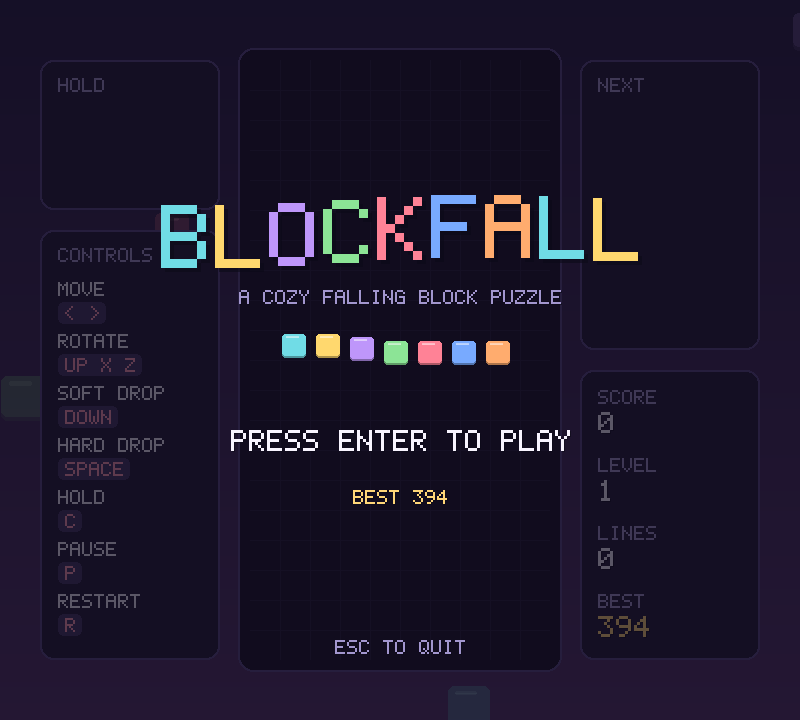
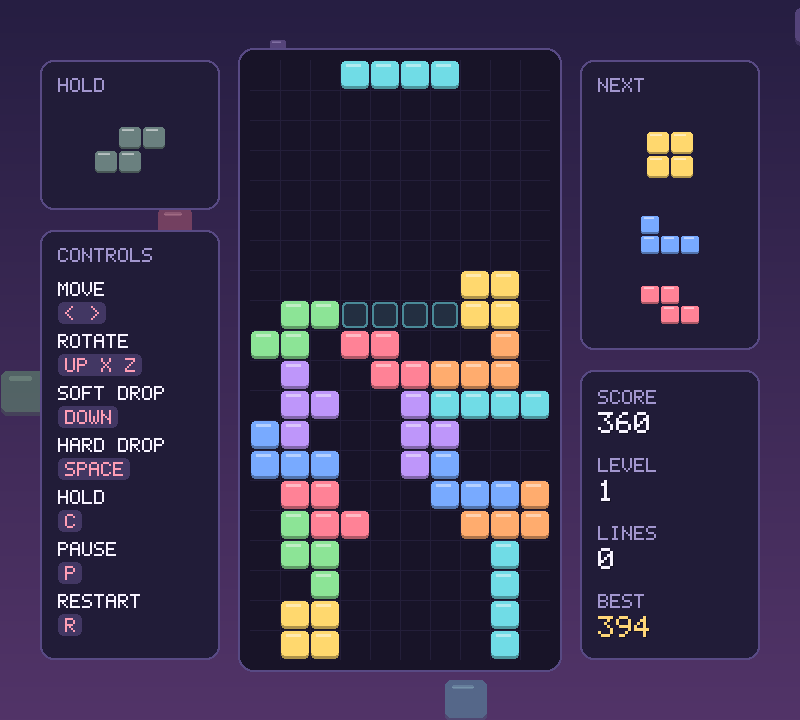

# Blockfall

A falling block puzzle game written in C++17 with SDL2.

Pastel colors, little particle effects, and a hand-made pixel font, so there
are no extra asset files to ship. Just build and play.

<p align="center">
  
  
</p>

## Features

- SRS rotation with wall kicks
- 7-bag randomizer
- Ghost piece, hold, and a 3-piece preview
- Lock delay and DAS/ARR for smooth left/right movement
- Score, levels, combos, and a saved best score
- Line clear particles, pop-up text, and a small board shake on hard drop
- Resizable window

## Controls

| Key               | Action                 |
| ----------------- | ---------------------- |
| `←` `→`           | Move                   |
| `↑` / `X`         | Rotate clockwise       |
| `Z` / `Ctrl`      | Rotate counterclockwise|
| `↓`               | Soft drop              |
| `Space`           | Hard drop              |
| `C` / `Shift`     | Hold                   |
| `P` / `Esc`       | Pause                  |
| `R`               | Restart                |
| `Enter`           | Start / play again     |

## Building

You need a C++17 compiler, CMake 3.16+, and SDL2.

### Linux (Debian/Ubuntu)

```bash
sudo apt install build-essential cmake libsdl2-dev
cmake -S . -B build
cmake --build build -j
./build/blockfall
```

### macOS

```bash
brew install cmake sdl2
cmake -S . -B build
cmake --build build -j
./build/blockfall
```

### Windows

With [vcpkg](https://github.com/microsoft/vcpkg):

```bash
vcpkg install sdl2
cmake -S . -B build -DCMAKE_TOOLCHAIN_FILE=<vcpkg-root>/scripts/buildsystems/vcpkg.cmake
cmake --build build --config Release
```

## Project layout

```
src/
├── main.cpp       entry point
├── app.*          window, input, screens, drawing the scene
├── game.*         game rules: board, gravity, scoring, hold, queue
├── piece.*        piece shapes and wall kick tables
├── effects.*      particles, pop-up text, board shake
├── painter.*      drawing helpers: rounded rects, gradients, blocks, text
├── font.*         5x7 bitmap font
└── theme.hpp      color palette
```

## License

[MIT](LICENSE)
